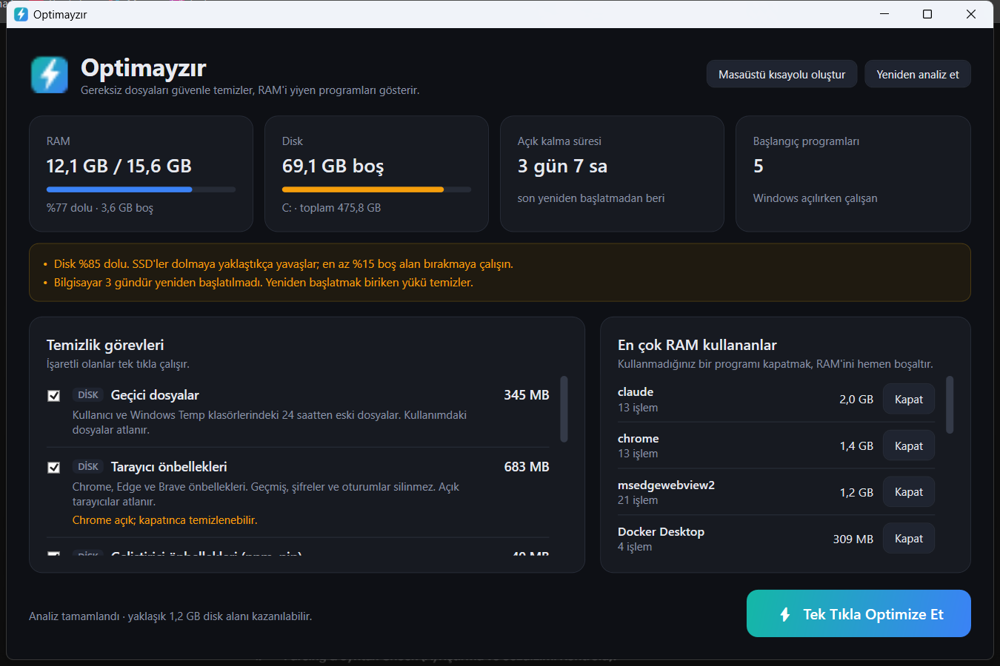

<p align="center">
  
</p>

<h1 align="center">Sweeply</h1>

<p align="center">Tek tıkla, <b>güvenli</b> Windows temizliği ve RAM takibi.</p>

<p align="center">
  
</p>

## Neden bir tane daha "optimizasyon" aracı?

Çoğu "RAM temizleyici", programların belleğini zorla boşaltır. Windows o verilere birkaç saniye sonra tekrar ihtiyaç duyar ve onları diskten geri okur. Sonuçta bilgisayar hızlanmaz, aksine kısa süreliğine yavaşlar.

Sweeply bunun yerine **gerçekten fark yaratan** işleri yapar:

- **Gereksiz dosyaları siler.** Silinen her şey zaten yeniden oluşturulabilir türden dosyalardır: önbellekler, geçici dosyalar, çökme dökümleri.
- **RAM'i kimin kullandığını gösterir.** Kullanmadığınız programı tek tıkla kapatabilirsiniz. Kapatmadan önce onay ister, program kaydetme sorabilsin diye önce nazikçe kapatmayı dener.
- **Sistemi yavaşlatan durumlar için uyarır:** disk dolmak üzereyse, bilgisayar günlerdir yeniden başlatılmadıysa veya açılışta çok program çalışıyorsa.

## Temizlik görevleri

| Bölüm | Görev | Ne yapar | Varsayılan |
|---|---|---|---|
| Sistem | Geçici dosyalar | Kullanıcı ve Windows Temp klasörlerindeki **24 saatten eski** dosyalar. Kullanımdaki dosyalar atlanır. | ✅ |
| Sistem | Çökme dökümleri | `CrashDumps` ve Windows hata raporu arşivi. | ✅ |
| Sistem | Windows Update önbelleği 🛡 | `SoftwareDistribution\Download`. Temizlik sırasında Windows Update servisi kısa süre durdurulur, sonra yeniden başlatılır. | ✅ |
| Sistem | Teslim İyileştirme 🛡 | `Delete-DeliveryOptimizationCache` ile Windows'un güncelleme paylaşım önbelleği. | ✅ |
| Uygulamalar | Tarayıcı önbellekleri | Chrome, Edge, Brave, Vivaldi, Opera, Opera GX ve Firefox. Sadece `Cache`, `Code Cache`, `GPUCache` ve Firefox'un `cache2` klasörü; geçmiş, şifreler ve çerezler **silinmez**. | ✅ |
| Uygulamalar | Uygulama önbellekleri | Discord, Slack ve VS Code önbellekleri. Oturumlar ve ayarlar silinmez. | ✅ |
| Uygulamalar | Spotify önbelleği | Birkaç GB olabilir; ancak indirilen (çevrimdışı) şarkılar da aynı klasörde durabildiği için varsayılan olarak kapalı. | ⬜ |
| Geliştirici | Paket yöneticisi önbellekleri | npm, Yarn, pnpm (`store prune`, sadece kullanılmayan paketler), pip ve NuGet indirme önbelleği. | ✅ |
| Geliştirici | Derleme paket depoları | `~/.nuget/packages`, Gradle, Cargo (`registry` ve `git`; `~/.cargo/bin` korunur) ve Go. Sonraki derleme her şeyi yeniden indirir. | ⬜ |
| Geliştirici | Docker build cache | Sadece `docker builder prune -a`. **İmajlara, konteynerlere ve volume'lara dokunmaz.** | ✅ |
| Geliştirici | Docker sanal diskini küçült 🛡 | Docker içinde boşalan alanı Windows'a geri verir: Docker Desktop ve WSL kapatılır, `docker_data.vhdx` salt okunur bağlanıp `diskpart compact vdisk` ile küçültülür. Veri silinmez. | ⬜ |
| Bellek | WSL ve Docker'ı kapat | `wsl --shutdown` ile birkaç GB RAM geri kazandırır. Çalışan konteynerler durur. | ⬜ |

🛡 Yönetici izni gerekir: uygulamadaki **Yönetici olarak aç** ile yeniden başlatın. Bu görevler yönetici olmadan da boyutlarını gösterir ama hiçbir şey silmez. Zamanlanmış otomatik temizlikte de çalışmazlar.

Açık olan bir tarayıcının veya uygulamanın önbelleği o turda atlanır. **Neler silinecek?** butonu, hiçbir şey silmeden hangi klasörlerin ne kadar yer kapladığını ve hangi komutların çalışacağını listeler. Temizlik sırasında canlı ilerleme görünür ve **Durdur** ile istediğiniz an kesebilirsiniz.
Geri Dönüşüm Kutusu, İndirilenler klasörü ve kişisel dosyalar **hiçbir zaman** silinmez. Junction ve sembolik bağlantıların içine girilmez, yani temizlik hedef klasörün dışına taşamaz.

## Kurulum

**Hazır sürüm:** [Releases](../../releases) sayfasından `Sweeply.exe` dosyasını indirip çalıştırın. Tek dosyadır, .NET kurmanız gerekmez.

**Kaynaktan kurulum** (.NET 8 SDK gerekir):

```powershell
git clone https://github.com/AlperEnesErsu/Sweeply.git
cd Sweeply
powershell -ExecutionPolicy Bypass -File install.ps1
```

Bu betik uygulamayı `%LOCALAPPDATA%\Programs\Sweeply` klasörüne kurar ve masaüstüne bir **Sweeply** kısayolu ekler.

## Kullanım

- **Masaüstü kısayolu** uygulamayı `--auto` parametresiyle açar: pencere açılır, analiz yapılır ve seçili görevler **otomatik olarak** çalışır.
- Uygulamayı normal açarsanız önce analiz sonuçlarını görürsünüz. İstediğiniz görevleri işaretleyip **Temizle** butonuna basarsınız.
- Kısayolu uygulama içinden de oluşturabilirsiniz: **Masaüstü kısayolu**.

Normalde yönetici izni gerekmez; yönetici yetkisi gerektiren dosyalar (ör. bazı `C:\Windows\Temp` içerikleri) sessizce atlanır. **Son tam açılıştan beri** alanı, Windows'un Hızlı Başlangıç özelliği açıksa bunu fark eder: bu durumda "Kapat" bilgisayarı tam kapatmaz ve süre sıfırlanmaz. Alana tıklayınca son açılışlar türleriyle (tam açılış / Hızlı Başlangıç) listelenir ve güç ayarları tek tıkla açılır. **Başlangıç programları** alanına tıklayınca açılışta çalışan programlar listelenir ve Görev Yöneticisi'nin Başlangıç sekmesi tek tıkla açılır. Windows'ta "Animasyon efektleri" kapalıysa uygulamadaki animasyonlar da kapanır. Başlangıç programları listesinde bir programın işaretini kaldırmak onu silmez, yalnızca açılışta çalışmasını engeller (Görev Yöneticisi'ndeki "Devre dışı bırak" ile aynı).

### Klasörler

**Klasörler** butonuyla kendi temizlik klasörlerinizi ekleyebilirsiniz; içlerindeki 24 saatten eski dosyalar **Kendi klasörlerim** görevinde silinir. Bir klasörü **hariç tutarsanız** hiçbir görev ona dokunmaz; o klasörü kendi komutuyla silebilecek araç komutları (ör. `npm cache clean`) da o turda çalıştırılmaz. Kişisel klasörler (Belgeler, Masaüstü, İndirilenler…), sürücü kökleri ve Windows/Program Files klasörleri eklenemez.

### Haftalık otomatik temizlik

**Zamanlama** butonu, seçili görevleri haftada bir, seçtiğiniz gün ve saatte **onay sormadan** çalıştıran bir Görev Zamanlayıcı görevi oluşturur. Pencere hangi görevlerin çalışacağını ve yönetici izni gerektirdiği için hangilerinin atlanacağını gösterir. Görev yönetici izni olmadan, yalnızca sizin hesabınızda çalışır. Bilgisayar o saatte kapalıysa o haftanın temizliği yapılmaz. Zamanlama yalnızca kurulu `Sweeply.exe` ile yapılabilir. Bir zamanlanmış temizlikten sonra Sweeply'i ilk açtığınızda sonucun özeti bir kez gösterilir: her görevin sonucu ve çalışmadıysa nedeni.

### Ayarlar

Seçimler, klasörler, zamanlama ve RAM listesinde gösterilmeyecek programlar `%LOCALAPPDATA%\Sweeply\settings.json` içinde tutulur. Korunan programlar şimdilik dosyadan eklenir: `"ProtectedProcesses": ["obs64"]`. Dosya bozulursa Sweeply varsayılan ayarlarla açılır, eski dosyanın kopyasını `settings.json.bozuk` olarak saklar ve bunu bir uyarıyla söyler. Kopya alınamazsa o oturumda ayarlar kaydedilmez, böylece eski dosya kaybolmaz.

## İpucu: Docker'ın kapladığı alanı Windows'a geri vermek

Docker build cache'i silindiğinde alan Docker'ın sanal diski (`docker_data.vhdx`) içinde boşalır, ama dosyanın kendisi küçülmez. Bunu Sweeply'de **Docker sanal diskini küçült** görevi yapar: uygulamayı yönetici olarak açıp görevi seçin. Görev, Docker Desktop kapanmazsa diske dokunmaz. Yolda Türkçe ya da özel karakter varsa (ör. kullanıcı adınızda "ö" geçiyorsa) güvenlik için çalışmaz. O durumda veya elle yapmak isterseniz:

1. Docker Desktop'tan çıkın (**Quit Docker Desktop**).
2. **Yönetici olarak** bir terminal açıp şunları çalıştırın:

```powershell
wsl --shutdown
diskpart
```

```text
select vdisk file="C:\Users\<kullanıcı>\AppData\Local\Docker\wsl\disk\docker_data.vhdx"
attach vdisk readonly
compact vdisk
detach vdisk
exit
```

## Geliştirme

```powershell
dotnet build Sweeply.sln
dotnet test Sweeply.sln
dotnet run --project src/Sweeply
```

Testler dosya silme algoritmalarını her seferinde yeni oluşturulan geçici klasörlerde dener. Kapsanan senaryolar:
- Yaş filtresi
- Kullanımdaki ve salt okunur dosyalar
- Boşalan klasörlerin kaldırılması
- Junction'ların takip edilmemesi
- Tarayıcı geçmişi, şifre ve çerez dosyalarının korunması
- Açık tarayıcıların atlanması
- Docker çıktılarının ayrıştırılması
- İşlem gruplama
- Komut zaman aşımı ve standart girdi
- Ayar dosyasının bozulması, yedeklenmesi ve yarıda kalan kayıtlar
- Zamanlama argümanları (gün kodları, saat) ve zamanlanmış çalışma özeti
- Docker sanal diski küçültme: yönetici kontrolü, Docker kapanmazsa diske dokunulmaması, diskpart hata verirse diskin ayrılması, iptal

Yeni bir önbellek eklemek çoğu zaman tek satırdır: `src/Sweeply/Tasks/Catalog.cs` içinde ilgili göreve bir `CacheApp` (uygulama adı, açıkken atlanacak işlemler, klasörler veya temizleme komutu) ekleyin. Analiz, önizleme, iptal ve ilerleme otomatik gelir. Tek dosyalık exe için: `dotnet publish src/Sweeply/Sweeply.csproj -p:PublishProfile=win-x64`. Uygulama ikonu `tools/make-icon.ps1` ile üretilir.

## Lisans

[MIT](LICENSE)
